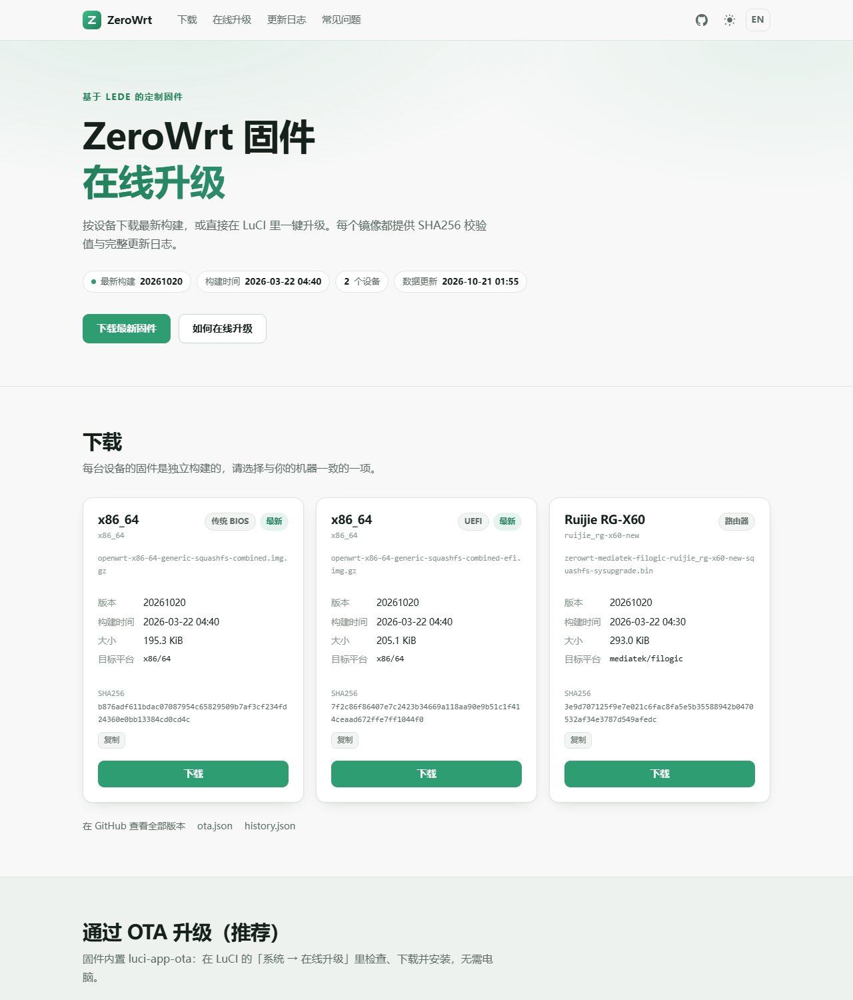

# luci-app-ota

一个简洁、可靠的 OpenWrt / LEDE **在线升级（OTA）** LuCI 插件：在 Web 界面里检查、下载、校验并安装新固件。

面向自建固件仓库设计（本插件就是为 [ZeroWrt](https://github.com/MinimaxFlora/ZeroWrt) 写的），
同时兼容任何提供一份 JSON 更新索引的固件。

## 特性

- **同时支持 opkg 和 apk**：同一份 `Makefile`，在 OpenWrt 24.10（opkg）与 25.12 / SNAPSHOT（apk）构建树里都能编译出可安装的包。
- **符合官方 LuCI 插件规范**（新版 JS 前端）：
  - `root/usr/share/luci/menu.d/*.json` 菜单
  - `root/usr/share/rpcd/acl.d/*.json` 权限
  - `root/usr/share/rpcd/ucode/*` 基于 ucode 的 rpcd 对象
  - `htdocs/luci-static/resources/view/ota/*.js` 前端视图（`view` / `form` / `rpc` / `E()`）
  - `po/` 多语言，自带简体中文
- **自带固件下载页**：`site/` 里的静态页面发布到 GitHub Pages，按设备列出最新镜像、SHA256 与更新日志，并给出 OTA 升级步骤。
- **不依赖自编译 C 程序**：下载用系统现有的 `curl` / `uclient-fetch` / `wget`，自动选择。
- **进度真实**：后台下载进程 + 文件大小推算进度，页面显示百分比、速度、剩余时间、进度条。
- **强制 SHA256 校验**：索引里没有 SHA256 直接拒绝下载；校验失败自动丢弃。
- **下载后预检镜像**：用 `sysupgrade -T` 校验镜像是否属于当前设备，避免刷错固件（可关闭）。
- **断点续传**（有 `curl` 时）：同一次下载里网络抖动会自动从已下载位置继续。
- **命令行**：`/usr/bin/ota check|download|status|cancel|apply`，输出 JSON，方便脚本调用。
- **版本比较可靠**：优先用构建时间戳（`/etc/ota/build.json` 或 `/etc/os-release` 的 `OPENWRT_BUILD_DATE`），退化为版本号比较。
- **默认安全**：索引地址必须 `https`，否则需要显式打开「允许不安全的连接」。

## 目录结构

```
Makefile                                   # luci.mk 包定义（opkg / apk 通用）
root/etc/config/ota                        # UCI 配置
root/usr/bin/ota                           # ucode 后端（全部逻辑）
root/usr/libexec/ota-download              # 后台下载进程（shell）
root/usr/share/rpcd/ucode/luci.ota         # rpcd 对象 luci.ota（薄封装）
root/usr/share/rpcd/acl.d/luci-app-ota.json
root/usr/share/luci/menu.d/luci-app-ota.json
htdocs/luci-static/resources/view/ota/overview.js       # 系统 -> 在线升级 -> 概览
htdocs/luci-static/resources/view/ota/configuration.js  # 系统 -> 在线升级 -> 配置
po/zh_Hans/ota.po                          # 简体中文翻译
site/                                      # 固件下载页（发布到 gh-pages）
tools/gen_ota_index.py                     # 生成 ota.json 与 history.json
tools/embed_ota_meta.py                    # 编译时写 /etc/ota/build.json
tools/publish_site.sh                      # 把页面与索引推送到 gh-pages 分支
```

## 安装

### 1. 编译进固件（推荐）

```sh
cd openwrt            # 或 LEDE / lede 源码根目录
git clone https://github.com/MinimaxFlora/luci-app-ota.git package/luci-app-ota
```

然后在 `.config` 里启用：

```ini
CONFIG_PACKAGE_luci-app-ota=y
CONFIG_PACKAGE_luci-i18n-ota-zh-cn=y   # 可选：简体中文界面
```

也可以在 `make menuconfig` 里选：`LuCI → Applications → luci-app-ota`。

> 必须在 `feeds update -a && feeds install -a` 之后克隆，`luci.mk` 位于 `feeds/luci/luci.mk`。
>
> 依赖：`luci-base`、`rpcd` / `rpcd-mod-ucode`、`ucode`（含 `ucode-mod-fs`、`ucode-mod-uci`）、`curl`。
> 这些在 24.10 与 25.12 的默认 LuCI 里本来就有，显式声明是为了精简过的固件也能装上。
> 如果固件里精简掉了 `curl`，插件仍能工作（自动退回 `uclient-fetch`），但没有断点续传。

### 2. 在已运行的设备上安装

```sh
# OpenWrt 24.10 / LEDE（opkg）
opkg install luci-app-ota_*.ipk

# OpenWrt 25.12+（apk）
apk add --allow-untrusted luci-app-ota-*.apk
```

装好后刷新 LuCI，菜单在 **系统 → 在线升级**。

> **注意**：如果你在 Windows 上克隆本仓库再打包，`/usr/bin/ota` 与
> `/usr/libexec/ota-download` 可能丢失可执行位。用 `git update-index --chmod=+x`
> 处理，或在 Linux 上克隆。CI 里构建不受影响。

## 配置项

`/etc/config/ota`（也可以在「在线升级 → 配置」里改）：

| 选项 | 默认值 | 说明 |
| --- | --- | --- |
| `api_url` | 空 | 更新索引 JSON 的 URL，未填时页面会提示去配置 |
| `device` | 空 | 手动指定设备标识，留空自动识别 |
| `auto_check` | `1` | 打开页面且距上次检查超过 10 分钟时自动检查 |
| `keep_settings` | `1` | 安装页「保留设置」默认勾选 |
| `verify_image` | `1` | 下载完成后用 `sysupgrade -T` 预检镜像 |
| `ipv4_only` | `1` | 索引与固件下载只走 IPv4 |
| `allow_insecure` | `0` | 允许 `http://` 并跳过 TLS 校验 |

## 更新索引格式

推荐格式（`schema: 2`）：

```json
{
  "schema": 2,
  "generated": 1774124800,
  "dist": "ZeroWrt",
  "devices": {
    "ruijie_rg-x60-new": {
      "version": "20261020",
      "build_date": 1774124635,
      "url": "https://github.com/MinimaxFlora/ZeroWrt/releases/download/ruijie_rg-x60-new/zerowrt-mediatek-filogic-ruijie_rg-x60-new-squashfs-sysupgrade.bin",
      "sha256": "6f1c…",
      "size": 33554432,
      "file": "zerowrt-mediatek-filogic-ruijie_rg-x60-new-squashfs-sysupgrade.bin",
      "target": "mediatek/filogic",
      "device": "ruijie_rg-x60-new",
      "changelog": "## 20261020\n\n- 更新内核到 6.18\n- 修复 xxx"
    },
    "x86_64+bios": { "...": "x86 传统 BIOS 镜像" },
    "x86_64+efi": { "...": "x86 EFI 镜像" },
    "x86_64": { "...": "同 +bios，作为兜底" }
  }
}
```

字段说明：

| 字段 | 必填 | 说明 |
| --- | --- | --- |
| `url` | 是 | 固件下载地址（`http(s)`） |
| `sha256` | 是 | 固件 SHA256，下载后强制校验 |
| `build_date` | 建议 | 构建时间（Unix 时间戳），优先用它判断新旧 |
| `version` | 建议 | 版本号，没有 `build_date` 时用它比较 |
| `size` | 建议 | 字节数，用于显示进度/检查空间 |
| `changelog` | 否 | Markdown，显示在界面上 |
| `file` | 否 | 文件名，仅用于显示 |
| `target` / `device` | 否 | 仅用于显示 |
| `label` | 否 | 设备的人类可读名称，下载页显示用 |
| `variant` | 否 | x86 变体（`bios` / `efi`），下载页显示用 |

> 索引里一台设备只写一个 key：构建元数据里的 profile 名（如 `ruijie_rg-x60-new`）。
> 插件同时会试 `ruijie,rg-x60-new` 和 `ruijie_rg-x60-new` 两种写法（设备树 model
> 与 profile 名的对应），所以索引里不需要重复写。要给只认设备树名的第三方客户端用，
> 可以加 `--aliases all`。

同时也兼容 `luci-app-ota`（sbwml 版）的扁平格式，并自动取数组里 `build_date` 最大的一项：

```json
{ "x86_64": [ { "build_date": "1774124660", "sha256sum": "…", "url": "…", "logs": "…" } ] }
```

### 设备标识（key）的匹配顺序

插件按以下顺序生成候选 key，命中第一个即使用：

1. UCI `ota.config.device`（手动指定）
2. `/etc/ota/build.json` 的 `device`（设备 profile，如 `ruijie_rg-x60-new`）
3. 同一文件的 `model`（DT compatible，如 `ruijie,rg-x60-new`）
4. `/etc/os-release` 的 `OPENWRT_BOARD`（如 `mediatek/filogic`）
5. `/tmp/sysinfo/board_name`
6. `/etc/board.json` 的 `model.id`
7. 由 profile 推导的 `vendor,device`、架构名
8. x86 额外追加 `x86_64`、`x86/64`、`generic`

x86 有两套镜像（传统 BIOS / EFI），因此 x86 会优先匹配带 `+bios` / `+efi` 后缀的 key
（依据 `/sys/firmware/efi` 是否存在判断），再退回不带后缀的 key。

### 版本比较规则

- 两边都有构建时间戳 → 远端时间更新才算「有新版本」（推荐，最可靠）；
- 否则比较版本号（按数字/非数字分段，`20261020` > `20261001`）；
- 都没有 → 提示无法判断，不会误报。

## 接入自己的固件构建

插件不绑定任何发行版。任何能产出固件镜像的构建流程，只要做三件事即可：

1. **编译进固件**：把本仓库放到源码树（例如 `package/new/luci-app-ota`），
   `.config` 里加 `CONFIG_PACKAGE_luci-app-ota=y`（可选 `luci-i18n-ota-zh-cn`）。
2. **写入构建元数据**：编译前跑
   `tools/embed_ota_meta.py --tree <源码树> --info <构建信息.json> --api-url <索引地址>`。
   它会写 `/etc/ota/build.json`（设备名 + 构建时间戳）、同步 `version.date`，
   并把索引地址写进 `/etc/uci-defaults/90-luci-app-ota` 作为默认值（用户改过的配置优先）。
   这一步可以省略，只是固件无法自报构建时间，插件会退回按版本号比较。
3. **发布索引与页面**：产出镜像后跑
   `tools/publish_site.sh --repo <owner/repo> --dist <产物目录> ... --branch gh-pages`，
   生成/合并 `ota.json`、追加 `history.json`，连同 `site/` 一起推到 Pages 分支。

`--info` 是一个可选的 JSON，字段缺失会自动推导（`device` / `model` 决定索引 key 的别名，
`device_vendor` + `device_model` 只用于页面显示名）：

```json
{ "board": "mediatek", "subtarget": "filogic",
  "device": "ruijie_rg-x60-new",
  "device_vendor": "Ruijie", "device_model": "RG-X60",
  "version": "20261020" }
```

GitHub Actions 里的最小片段（命令与具体发行版无关）：

```yaml
      - name: OTA metadata
        run: |
          owner="$(echo "$GITHUB_REPOSITORY_OWNER" | tr 'A-Z' 'a-z')"
          repo="$(basename "$GITHUB_REPOSITORY")"
          python3 tools/embed_ota_meta.py --tree "$BUILD_TREE" \
            --info build-info.json \
            --api-url "https://${owner}.github.io/${repo}/ota.json"

      # ... 编译固件 ...

      - name: Publish OTA page
        if: success()
        env:
          GH_TOKEN: ${{ secrets.GITHUB_TOKEN }}
        run: |
          sh tools/publish_site.sh --repo "$GITHUB_REPOSITORY" --dist dist \
            --device "$DEVICE" --target "$TARGET" --version "$VERSION" \
            --branch gh-pages
```

推送后到仓库 `Settings → Pages` 选 **Deploy from a branch / `gh-pages` / `/`**。
之后固件就在 `https://<owner>.github.io/<repo>/ota.json` 上检查更新。

想用自己的域名：把域名写进 `site/CNAME`（例如 `ota.example.com`），并在 DNS 里加一条
`CNAME ota.example.com → <owner>.github.io`（Cloudflare 记得关掉代理，保持 DNS only），
然后在 Pages 设置里填同一个域名，等证书签发后勾上 Enforce HTTPS。

## 固件下载页（GitHub Pages）

发布脚本会把 `site/` 里的静态页面连同数据一起推到固件仓库的 `gh-pages` 分支，
GitHub Pages 直接托管（分支根目录，`.nojekyll` 已带）：

```
https://<owner>.github.io/<repo>/               # 下载页
https://<owner>.github.io/<repo>/ota.json       # 插件用的更新索引
https://<owner>.github.io/<repo>/history.json   # 页面用的历史记录
```

（示例部署：<https://minimaxflora.github.io/ZeroWrt/>）

分支内容：

| 文件 | 说明 |
| --- | --- |
| `index.html` `assets/` | 来自 `site/`，改样式/文案只改这里 |
| `ota.json` | 最新一次索引（与插件同源，多设备条目合并） |
| `history.json` | 每次构建追加一条，页面据此渲染更新日志，默认保留 120 条 |
| `.nojekyll` | 跳过 Jekyll，保证 `assets/` 原样发布 |



页面特性：

- 按设备卡片列出最新镜像：版本、构建时间、大小、SHA256（点「复制」），直接下载；
- x86 的 `传统 BIOS` / `UEFI` 用徽章区分，避免刷错；
- 更新日志可按设备筛选，Markdown 渲染，带「最新」标记与 GitHub 发布页链接；
- 中英文切换（`?lang=en` 可直接指定）、明暗主题、移动端适配，零外部依赖（不引用 CDN）。

本地预览（不需要联网）：

```sh
# 用真实产物生成一次页面数据
tools/publish_site.sh --repo MinimaxFlora/ZeroWrt --dist dist \
  --device x86_64 --target x86/64 --version 20261021 \
  --build-date "$(date +%s)" --site site --no-push

python3 -m http.server -d _site 8000   # 打开 http://localhost:8000
```

换品牌：改 `site/assets/app.js` 顶部的 `CONFIG`（名称、仓库、设备别名），
以及 `site/index.html` 里的文案与 `site/assets/logo.png`。

## 命令行

```sh
ota info                 # 本地固件信息 + 缓存的检查结果
ota check                # 拉取索引并比较版本
ota download             # 后台开始下载
ota status               # 下载状态/进度（JSON）
ota cancel               # 取消下载
ota apply --keep 1       # 安装（1=保留设置，0=不保留）
```

全部输出单个 JSON 对象，`ok` 为 `false` 时退出码非 0：

```sh
ota check | jsonfilter -e '@.check.remote.version'
```

## 工作原理

```
浏览器 (overview.js)
   │  ubus: luci.ota.{info,check,status,download,cancel,apply}
   ▼
rpcd ucode 模块 (/usr/share/rpcd/ucode/luci.ota)
   │  fork + exec
   ▼
/usr/bin/ota (ucode, 全部逻辑)
   ├── 拉取索引      → curl / uclient-fetch
   ├── 后台下载      → /usr/libexec/ota-download（curl -C - / uclient-fetch）
   │                     ↓ 校验 SHA256 → sysupgrade -T 预检 → 原子改名
   └── 安装         → sysupgrade [-n] /tmp/luci-ota/dl/firmware.img
```

运行期文件都在 `/var/run/ota/`（tmpfs，重启即清空）：

```
/var/run/ota/check.json          # 最近一次检查结果
/var/run/ota/index.json          # 最近一次索引原文
/var/run/ota/dl/firmware.img     # 校验通过的固件
/var/run/ota/dl/download.log     # 下载日志
```

## 安全说明

- 索引必须是 `https`（除非显式 `allow_insecure`）。
- 下载完成必须通过 **SHA256** 校验，否则丢弃；索引缺 SHA256 直接拒绝下载。
- 安装前可用 `sysupgrade -T` 让系统自己确认镜像属于本设备；即使绕过，
  `sysupgrade` 真正写入前也会再校验一次镜像元数据。
- 只有拥有 `luci-app-ota` 权限的 LuCI 用户（默认即 root）才能触发下载与安装。

## 常见问题

**检查更新提示「索引中没有适用于此设备的固件」**
页面「当前固件」里的 **设备标识** 就是插件查的 key，把它加到索引里即可（或用
`ota config device` 手动指定）。

**一直显示「未配置更新索引」**
`/etc/config/ota` 的 `api_url` 为空。到「配置」页填上，或 `uci set ota.config.api_url=...`。

**`/tmp` 空间不足**
固件镜像下载到 `/tmp`（内存盘，通常是 RAM 的一半）。x86 镜像较大时请确保
设备内存足够，或先 `sysupgrade` 到更大内存的版本。

**想关闭下载后预检**
配置里关掉 `verify_image`，或 `uci set ota.config.verify_image=0`。

**下载页上的设备名不对 / 想加一台设备**
索引里的 `label` 决定卡片标题（`gen_ota_index.py --label`，ZeroWrt 会自动取
`.zerowrt-info.json` 里的厂商 + 型号）；没有 `label` 时用设备标识，再不行就到
`site/assets/app.js` 的 `CONFIG.labels` 里加一条映射。

**如何只看某个设备的更新日志**
在下载页的「更新日志」区域点设备名即可筛选。

## 致谢

设计思路参考了 [sbwml/openwrt_pkgs](https://github.com/sbwml/openwrt_pkgs) 的
`luci-app-ota` / `otahelper`（jjm2473、sbwml），本项目的实现为独立重写：
后端用 ucode 完成索引解析与状态机，下载进程负责校验与原子落盘，前端用官方
JS 视图规范实现。

## 许可证

MIT
